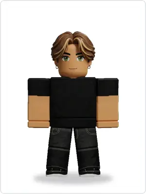

  
  

<picture>
  <source media="(prefers-color-scheme: dark)" srcset="https://raw.githubusercontent.com/PepeHenrque/PepeHenrque/output/secao-sobre-dark.svg">
  
</picture>

Me chamo Pedro Henrique Gomes de Lima e estou no quarto período de Ciência da Computação.

Tenho interesse pela teoria por trás da computação, além de matemática e filosofia. Também gosto de eletrônica e Arduino como forma de explorar a computação na prática, fora da tela.

Sou movido por curiosidade: gosto de aprender coisas novas e de compartilhar o que aprendo.

**Destaque:** minha equipe ficou entre as 15 melhores do país no desafio Quantum AI.

<picture>
  <source media="(prefers-color-scheme: dark)" srcset="https://raw.githubusercontent.com/PepeHenrque/PepeHenrque/output/secao-projetos-dark.svg">
  
</picture>

<!-- projetos:inicio -->

<a href="https://github.com/PepeHenrque/AGRODEMANDA"><picture>
  <source media="(prefers-color-scheme: dark)" srcset="https://raw.githubusercontent.com/PepeHenrque/PepeHenrque/output/projeto-pepehenrque-agrodemanda-dark.svg">
  
</picture></a>
<a href="https://github.com/PepeHenrque/apts"><picture>
  <source media="(prefers-color-scheme: dark)" srcset="https://raw.githubusercontent.com/PepeHenrque/PepeHenrque/output/projeto-pepehenrque-apts-dark.svg">
  
</picture></a>

<!-- projetos:fim -->

<picture>
  <source media="(prefers-color-scheme: dark)" srcset="https://raw.githubusercontent.com/PepeHenrque/PepeHenrque/output/secao-estudando-dark.svg">
  
</picture>

- C, Java e Python
- Arduino
- Infraestrutura como código: Terraform, Vagrant e Jenkins

<picture>
  <source media="(prefers-color-scheme: dark)" srcset="https://raw.githubusercontent.com/PepeHenrque/PepeHenrque/output/secao-stack-dark.svg">
  
</picture>

  
  

<picture>
  <source media="(prefers-color-scheme: dark)" srcset="https://raw.githubusercontent.com/PepeHenrque/PepeHenrque/output/secao-contribuicoes-dark.svg">
  
</picture>

<picture>
  <source media="(prefers-color-scheme: dark)" srcset="https://raw.githubusercontent.com/PepeHenrque/PepeHenrque/output/github-contribution-grid-snake-dark.svg">
  
</picture>

<picture>
  <source media="(prefers-color-scheme: dark)" srcset="https://raw.githubusercontent.com/PepeHenrque/PepeHenrque/output/secao-contato-dark.svg">
  
</picture>

[LinkedIn](https://www.linkedin.com/in/pedro-h-lima/)
