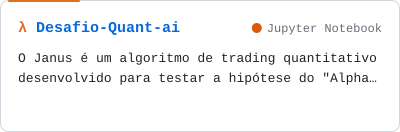

<picture>
  <source media="(prefers-color-scheme: dark)" srcset="https://raw.githubusercontent.com/PepeHenrque/PepeHenrque/output/nome-dark.svg?v=8">
  
</picture>

Me chamo Pedro Henrique Gomes de Lima, atualmente no quarto período de Ciência da Computação.

Tenho interesse particular pela teoria por trás da computação, além de matemática e filosofia.
Também gosto de eletrônica e Arduino como forma de explorar a computação na prática, fora da tela.

De forma geral, sou movido por curiosidade: gosto de aprender coisas novas e de compartilhar o que aprendo.

Estou estudando C, Java, Python e a linguagem do Arduino. Também venho me aprofundando em ferramentas de infraestrutura como código (IaC), como Terraform, Vagrant e Jenkins.

🏆Destaque: equipe classificada entre as 15 melhores do país no desafio Quantum AI.

<picture>
  <source media="(prefers-color-scheme: dark)" srcset="https://raw.githubusercontent.com/PepeHenrque/PepeHenrque/output/secao-tecnologias-dark.svg?v=8">
  
</picture>

  
  

<picture>
  <source media="(prefers-color-scheme: dark)" srcset="https://raw.githubusercontent.com/PepeHenrque/PepeHenrque/output/secao-estatisticas-dark.svg?v=8">
  
</picture>

  
  

<picture>
  <source media="(prefers-color-scheme: dark)" srcset="https://raw.githubusercontent.com/PepeHenrque/PepeHenrque/output/secao-contribuicoes-dark.svg?v=8">
  
</picture>

<picture>
  <source media="(prefers-color-scheme: dark)" srcset="https://raw.githubusercontent.com/PepeHenrque/PepeHenrque/output/secao-projetos-dark.svg?v=8">
  
</picture>

<!-- projetos:inicio -->

<a href="https://github.com/PepeHenrque/Desafio-Quant-ai"><picture>
  <source media="(prefers-color-scheme: dark)" srcset="https://raw.githubusercontent.com/PepeHenrque/PepeHenrque/output/projeto-pepehenrque-desafio-quant-ai-dark.svg?v=5d64940b">
  
</picture></a>

<!-- projetos:fim -->
